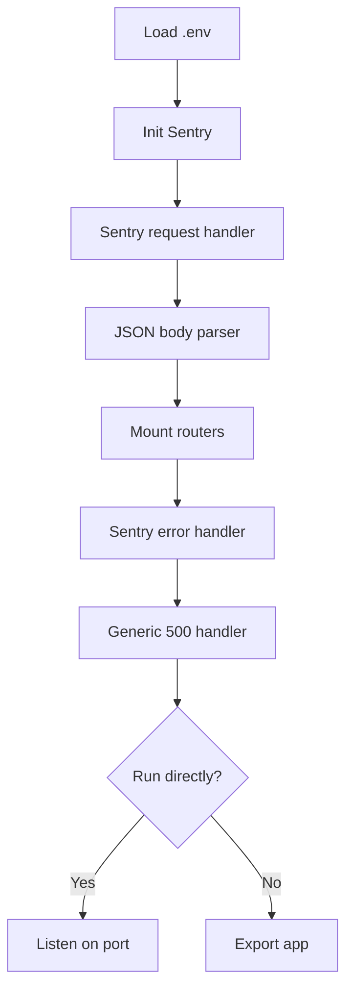
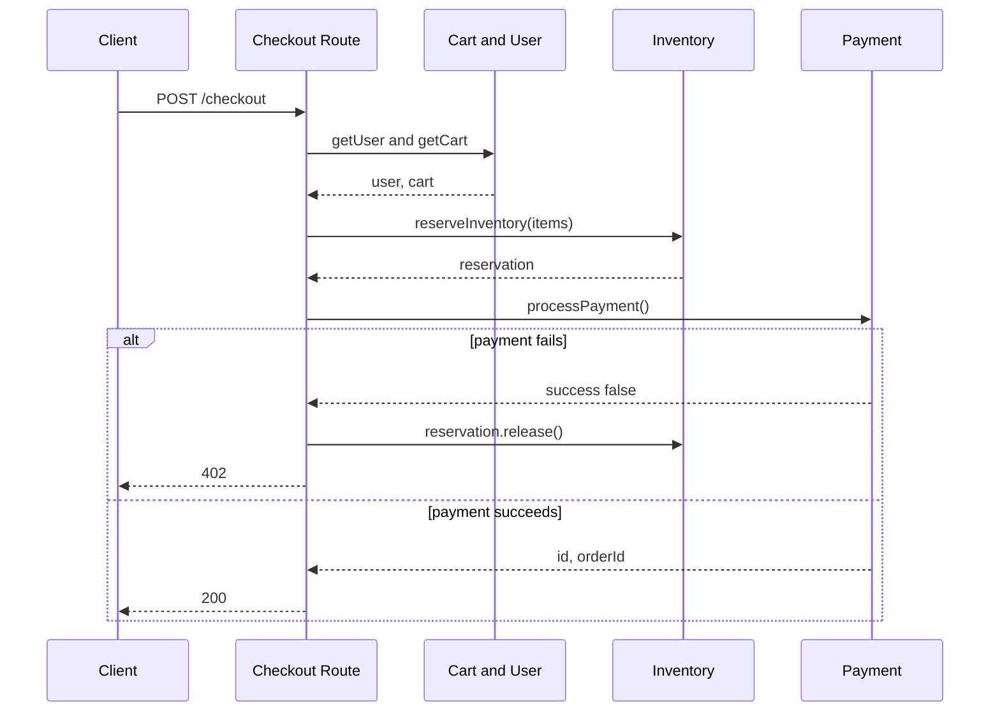

<!-- PAGE_ID: payment-service_02_architecture -->

📚 Relevant source files

The following files were used as context for generating this wiki page:

- [app.js:1-83](https://github.com/port-gh-app-dev/payment-service/blob/9a0f2d674fc3671ad15f41e6be1c9047bcf5fc14/src/app.js#L1-L83)
- [checkout.js:1-110](https://github.com/port-gh-app-dev/payment-service/blob/9a0f2d674fc3671ad15f41e6be1c9047bcf5fc14/src/routes/checkout.js#L1-L110)

# Architecture

> **Related Pages**: [[Services and Middleware|03_services.md]], [[API and Configuration|04_api-reference.md]]

---

<!-- BEGIN:AUTOGEN payment-service_02_architecture_bootstrap -->
## Application Bootstrap

`app.js` loads `.env` via dotenv, builds the Express app and mounts three routers ([app.js:1-8](https://github.com/port-gh-app-dev/payment-service/blob/9a0f2d674fc3671ad15f41e6be1c9047bcf5fc14/src/app.js#L1-L8), [app.js:32-34](https://github.com/port-gh-app-dev/payment-service/blob/9a0f2d674fc3671ad15f41e6be1c9047bcf5fc14/src/app.js#L32-L34)). `PORT` is parsed by `parsePort`, falling back to 3000 for empty or out-of-range values ([app.js:12-19](https://github.com/port-gh-app-dev/payment-service/blob/9a0f2d674fc3671ad15f41e6be1c9047bcf5fc14/src/app.js#L12-L19)). Sentry is initialised before routes with `sendDefaultPii: true` ([app.js:21-26](https://github.com/port-gh-app-dev/payment-service/blob/9a0f2d674fc3671ad15f41e6be1c9047bcf5fc14/src/app.js#L21-L26)).

The server only listens when run directly (`require.main === module`). In development (`NODE_ENV` defaults to `development`) it retries up to 30 successive ports on `EADDRINUSE`; otherwise it exits with code 1 ([app.js:44-80](https://github.com/port-gh-app-dev/payment-service/blob/9a0f2d674fc3671ad15f41e6be1c9047bcf5fc14/src/app.js#L44-L80)). The app is exported for tests ([app.js:82](https://github.com/port-gh-app-dev/payment-service/blob/9a0f2d674fc3671ad15f41e6be1c9047bcf5fc14/src/app.js#L82)).

Sources: [app.js:1-83](https://github.com/port-gh-app-dev/payment-service/blob/9a0f2d674fc3671ad15f41e6be1c9047bcf5fc14/src/app.js#L1-L83)
<!-- END:AUTOGEN payment-service_02_architecture_bootstrap -->

---

<!-- BEGIN:AUTOGEN payment-service_02_architecture_checkout-flow -->
## Checkout Flow

`POST /checkout` validates `userId`, `cartId` and `paymentMethodId` as non-empty trimmed strings (max 128/128/200 chars), returning 400 otherwise ([checkout.js:10-32](https://github.com/port-gh-app-dev/payment-service/blob/9a0f2d674fc3671ad15f41e6be1c9047bcf5fc14/src/routes/checkout.js#L10-L32)). It fetches user and cart in parallel ([checkout.js:37-41](https://github.com/port-gh-app-dev/payment-service/blob/9a0f2d674fc3671ad15f41e6be1c9047bcf5fc14/src/routes/checkout.js#L37-L41)), returns 404 if either is missing ([checkout.js:43-49](https://github.com/port-gh-app-dev/payment-service/blob/9a0f2d674fc3671ad15f41e6be1c9047bcf5fc14/src/routes/checkout.js#L43-L49)), and returns 400 for an empty cart ([checkout.js:53-55](https://github.com/port-gh-app-dev/payment-service/blob/9a0f2d674fc3671ad15f41e6be1c9047bcf5fc14/src/routes/checkout.js#L53-L55)). The total is the sum of `price * quantity` ([checkout.js:60-62](https://github.com/port-gh-app-dev/payment-service/blob/9a0f2d674fc3671ad15f41e6be1c9047bcf5fc14/src/routes/checkout.js#L60-L62)). Inventory is reserved before charging; failure yields 409 with `outOfStock` ([checkout.js:65-72](https://github.com/port-gh-app-dev/payment-service/blob/9a0f2d674fc3671ad15f41e6be1c9047bcf5fc14/src/routes/checkout.js#L65-L72)). Payment is made in USD ([checkout.js:75-81](https://github.com/port-gh-app-dev/payment-service/blob/9a0f2d674fc3671ad15f41e6be1c9047bcf5fc14/src/routes/checkout.js#L75-L81)); on failure the reservation is released and 402 returned ([checkout.js:83-87](https://github.com/port-gh-app-dev/payment-service/blob/9a0f2d674fc3671ad15f41e6be1c9047bcf5fc14/src/routes/checkout.js#L83-L87)). Success returns 200 with `orderId`, `total` and `estimatedDelivery` ([checkout.js:89-96](https://github.com/port-gh-app-dev/payment-service/blob/9a0f2d674fc3671ad15f41e6be1c9047bcf5fc14/src/routes/checkout.js#L89-L96)).

### Known defect

A code comment in the handler documents an intentional bug: `cart.items.length` is read before any null check, so a cart with `items: null` throws a `TypeError` (caught and returned as 500). The suggested fix is `if (!cart.items || cart.items.length === 0)` ([checkout.js:51-53](https://github.com/port-gh-app-dev/payment-service/blob/9a0f2d674fc3671ad15f41e6be1c9047bcf5fc14/src/routes/checkout.js#L51-L53)).

Sources: [checkout.js:25-108](https://github.com/port-gh-app-dev/payment-service/blob/9a0f2d674fc3671ad15f41e6be1c9047bcf5fc14/src/routes/checkout.js#L25-L108)
<!-- END:AUTOGEN payment-service_02_architecture_checkout-flow -->

---

<!-- BEGIN:AUTOGEN payment-service_02_architecture_error-handling -->
## Error Handling

The checkout handler wraps its logic in `try/catch`; errors are sent to Sentry via `captureException`, logged with stack, and answered with a generic 500 ([checkout.js:98-107](https://github.com/port-gh-app-dev/payment-service/blob/9a0f2d674fc3671ad15f41e6be1c9047bcf5fc14/src/routes/checkout.js#L98-L107)). At app level, `Sentry.Handlers.errorHandler()` is followed by a final middleware that logs "Unhandled error" and returns `{ error: 'Internal server error' }` ([app.js:36-42](https://github.com/port-gh-app-dev/payment-service/blob/9a0f2d674fc3671ad15f41e6be1c9047bcf5fc14/src/app.js#L36-L42)).

Sources: [checkout.js:98-107](https://github.com/port-gh-app-dev/payment-service/blob/9a0f2d674fc3671ad15f41e6be1c9047bcf5fc14/src/routes/checkout.js#L98-L107), [app.js:36-42](https://github.com/port-gh-app-dev/payment-service/blob/9a0f2d674fc3671ad15f41e6be1c9047bcf5fc14/src/app.js#L36-L42)
<!-- END:AUTOGEN payment-service_02_architecture_error-handling -->

---
