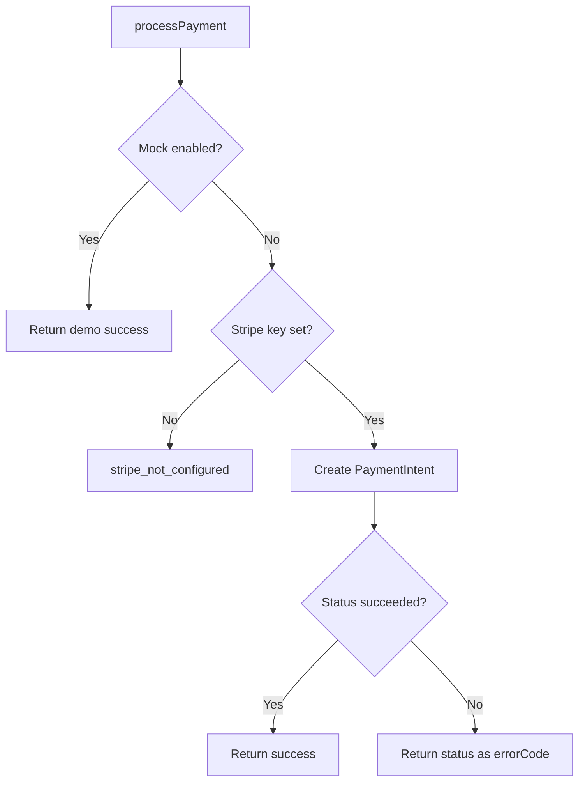

<!-- PAGE_ID: payment-service_03_services -->

📚 Relevant source files

The following files were used as context for generating this wiki page:

- [cart.js:1-48](https://github.com/port-gh-app-dev/payment-service/blob/9a0f2d674fc3671ad15f41e6be1c9047bcf5fc14/src/services/cart.js#L1-L48)
- [user.js:1-15](https://github.com/port-gh-app-dev/payment-service/blob/9a0f2d674fc3671ad15f41e6be1c9047bcf5fc14/src/services/user.js#L1-L15)
- [inventory.js:1-30](https://github.com/port-gh-app-dev/payment-service/blob/9a0f2d674fc3671ad15f41e6be1c9047bcf5fc14/src/services/inventory.js#L1-L30)
- [payment.js:1-56](https://github.com/port-gh-app-dev/payment-service/blob/9a0f2d674fc3671ad15f41e6be1c9047bcf5fc14/src/services/payment.js#L1-L56)
- [logger.js:1-12](https://github.com/port-gh-app-dev/payment-service/blob/9a0f2d674fc3671ad15f41e6be1c9047bcf5fc14/src/middleware/logger.js#L1-L12)

# Services and Middleware

> **Related Pages**: [[Architecture|02_architecture.md]]

---

<!-- BEGIN:AUTOGEN payment-service_03_services_cart-user -->
## Cart and User Services

Carts live in an in-memory `Map` seeded with two entries: a demo-bug cart whose `items` is `null` (id from `CHECKOUT_DEMO_BUG_CART_ID`, default `cart-null-items`) and `cart-with-items` ([cart.js:7-26](https://github.com/port-gh-app-dev/payment-service/blob/9a0f2d674fc3671ad15f41e6be1c9047bcf5fc14/src/services/cart.js#L7-L26)). Exports are `getCart`, `createCart` (new carts start with `items: null`) and `addItemToCart` ([cart.js:28-48](https://github.com/port-gh-app-dev/payment-service/blob/9a0f2d674fc3671ad15f41e6be1c9047bcf5fc14/src/services/cart.js#L28-L48)).

`getUser` returns `null` for a null/empty id and otherwise fabricates `{ id, email: "<id>@demo.local" }` ([user.js:4-13](https://github.com/port-gh-app-dev/payment-service/blob/9a0f2d674fc3671ad15f41e6be1c9047bcf5fc14/src/services/user.js#L4-L13)). Every non-empty user id therefore resolves.

Sources: [cart.js:7-48](https://github.com/port-gh-app-dev/payment-service/blob/9a0f2d674fc3671ad15f41e6be1c9047bcf5fc14/src/services/cart.js#L7-L48), [user.js:1-15](https://github.com/port-gh-app-dev/payment-service/blob/9a0f2d674fc3671ad15f41e6be1c9047bcf5fc14/src/services/user.js#L1-L15)
<!-- END:AUTOGEN payment-service_03_services_cart-user -->

---

<!-- BEGIN:AUTOGEN payment-service_03_services_inventory -->
## Inventory Service

`reserveInventory(items)` is a stub: it returns `{ success: false, outOfStockItems: [] }` for an empty or non-array input, otherwise stores a copy of the items in an in-memory map under a generated `res-…` id ([inventory.js:8-17](https://github.com/port-gh-app-dev/payment-service/blob/9a0f2d674fc3671ad15f41e6be1c9047bcf5fc14/src/services/inventory.js#L8-L17)). The result includes `release()`, which deletes the reservation and logs it ([inventory.js:19-27](https://github.com/port-gh-app-dev/payment-service/blob/9a0f2d674fc3671ad15f41e6be1c9047bcf5fc14/src/services/inventory.js#L19-L27)). It never reports items out of stock.

Sources: [inventory.js:1-30](https://github.com/port-gh-app-dev/payment-service/blob/9a0f2d674fc3671ad15f41e6be1c9047bcf5fc14/src/services/inventory.js#L1-L30)
<!-- END:AUTOGEN payment-service_03_services_inventory -->

---

<!-- BEGIN:AUTOGEN payment-service_03_services_payment -->
## Payment Service

`processPayment` has three paths ([payment.js:9-55](https://github.com/port-gh-app-dev/payment-service/blob/9a0f2d674fc3671ad15f41e6be1c9047bcf5fc14/src/services/payment.js#L9-L55)):

1. Mock: if `DEMO_MOCK_STRIPE` is `1` or `true`, it returns a fake success (`pi_demo_mock`) ([payment.js:10-20](https://github.com/port-gh-app-dev/payment-service/blob/9a0f2d674fc3671ad15f41e6be1c9047bcf5fc14/src/services/payment.js#L10-L20)).
2. Unconfigured: without `STRIPE_SECRET_KEY` it logs an error and returns `stripe_not_configured` ([payment.js:3-7](https://github.com/port-gh-app-dev/payment-service/blob/9a0f2d674fc3671ad15f41e6be1c9047bcf5fc14/src/services/payment.js#L3-L7), [payment.js:22-26](https://github.com/port-gh-app-dev/payment-service/blob/9a0f2d674fc3671ad15f41e6be1c9047bcf5fc14/src/services/payment.js#L22-L26)).
3. Live: creates a confirmed Stripe PaymentIntent with `amount` converted to cents ([payment.js:30-37](https://github.com/port-gh-app-dev/payment-service/blob/9a0f2d674fc3671ad15f41e6be1c9047bcf5fc14/src/services/payment.js#L30-L37)); `succeeded` returns success, any other status returns it as `errorCode` ([payment.js:39-48](https://github.com/port-gh-app-dev/payment-service/blob/9a0f2d674fc3671ad15f41e6be1c9047bcf5fc14/src/services/payment.js#L39-L48)); exceptions yield `err.code` or `stripe_error` ([payment.js:50-53](https://github.com/port-gh-app-dev/payment-service/blob/9a0f2d674fc3671ad15f41e6be1c9047bcf5fc14/src/services/payment.js#L50-L53)).

Order ids are `ORD-<timestamp>` and the estimated delivery is three days ahead ([payment.js:14-17](https://github.com/port-gh-app-dev/payment-service/blob/9a0f2d674fc3671ad15f41e6be1c9047bcf5fc14/src/services/payment.js#L14-L17), [payment.js:42-45](https://github.com/port-gh-app-dev/payment-service/blob/9a0f2d674fc3671ad15f41e6be1c9047bcf5fc14/src/services/payment.js#L42-L45)).

Sources: [payment.js:1-56](https://github.com/port-gh-app-dev/payment-service/blob/9a0f2d674fc3671ad15f41e6be1c9047bcf5fc14/src/services/payment.js#L1-L56)
<!-- END:AUTOGEN payment-service_03_services_payment -->

---

<!-- BEGIN:AUTOGEN payment-service_03_services_logger -->
## Logger

A winston logger at level `LOG_LEVEL` (default `info`), JSON format with timestamps, writing to the console ([logger.js:3-10](https://github.com/port-gh-app-dev/payment-service/blob/9a0f2d674fc3671ad15f41e6be1c9047bcf5fc14/src/middleware/logger.js#L3-L10)). Despite living in `middleware/`, it is a plain logger module, not an Express middleware.

Sources: [logger.js:1-12](https://github.com/port-gh-app-dev/payment-service/blob/9a0f2d674fc3671ad15f41e6be1c9047bcf5fc14/src/middleware/logger.js#L1-L12)
<!-- END:AUTOGEN payment-service_03_services_logger -->

---
