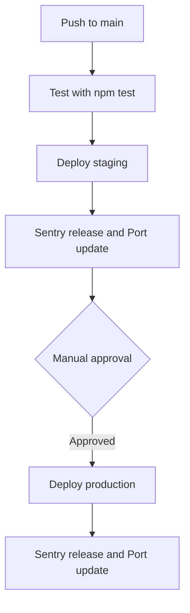

<!-- PAGE_ID: payment-service_05_testing-deployment -->

📚 Relevant source files

The following files were used as context for generating this wiki page:

- [jest.config.js:1-8](https://github.com/port-gh-app-dev/payment-service/blob/9a0f2d674fc3671ad15f41e6be1c9047bcf5fc14/jest.config.js#L1-L8)
- [jest.setup.js:1-2](https://github.com/port-gh-app-dev/payment-service/blob/9a0f2d674fc3671ad15f41e6be1c9047bcf5fc14/jest.setup.js#L1-L2)
- [health.test.js:1-14](https://github.com/port-gh-app-dev/payment-service/blob/9a0f2d674fc3671ad15f41e6be1c9047bcf5fc14/src/__tests__/health.test.js#L1-L14)
- [build.yml:1-30](https://github.com/port-gh-app-dev/payment-service/blob/9a0f2d674fc3671ad15f41e6be1c9047bcf5fc14/.github/workflows/build.yml#L1-L30)
- [deploy.yml:1-88](https://github.com/port-gh-app-dev/payment-service/blob/9a0f2d674fc3671ad15f41e6be1c9047bcf5fc14/deploy.yml#L1-L88)
- [README.md:93-123](https://github.com/port-gh-app-dev/payment-service/blob/9a0f2d674fc3671ad15f41e6be1c9047bcf5fc14/README.md#L93-L123)

# Testing, CI/CD and Runbook

> **Related Pages**: [[Overview|01_overview.md]]

---

<!-- BEGIN:AUTOGEN payment-service_05_testing-deployment_testing -->
## Testing

Jest runs in the `node` environment, matches `**/__tests__/**/*.test.js`, collects coverage from `src/**/*.js` and loads `jest.setup.js` ([jest.config.js:2-6](https://github.com/port-gh-app-dev/payment-service/blob/9a0f2d674fc3671ad15f41e6be1c9047bcf5fc14/jest.config.js#L2-L6)), which defaults `SENTRY_DSN` to an empty string ([jest.setup.js:2](https://github.com/port-gh-app-dev/payment-service/blob/9a0f2d674fc3671ad15f41e6be1c9047bcf5fc14/jest.setup.js#L2)). The only test is for `GET /health` via supertest, asserting status 200, `status: 'ok'`, `service: 'payments-service'` and a timestamp ([health.test.js:4-13](https://github.com/port-gh-app-dev/payment-service/blob/9a0f2d674fc3671ad15f41e6be1c9047bcf5fc14/src/__tests__/health.test.js#L4-L13)). The checkout route and services have no tests.

Run with `npm test` ([package.json:9](https://github.com/port-gh-app-dev/payment-service/blob/9a0f2d674fc3671ad15f41e6be1c9047bcf5fc14/package.json#L9)).

Sources: [jest.config.js:1-8](https://github.com/port-gh-app-dev/payment-service/blob/9a0f2d674fc3671ad15f41e6be1c9047bcf5fc14/jest.config.js#L1-L8), [health.test.js:1-14](https://github.com/port-gh-app-dev/payment-service/blob/9a0f2d674fc3671ad15f41e6be1c9047bcf5fc14/src/__tests__/health.test.js#L1-L14)
<!-- END:AUTOGEN payment-service_05_testing-deployment_testing -->

---

<!-- BEGIN:AUTOGEN payment-service_05_testing-deployment_ci-cd -->
## CI/CD

Two workflows exist:

- **Build** (`.github/workflows/build.yml`) runs on pushes and PRs to `main` using Node 18.x, `npm ci`, then `node src/index.test.js` ([build.yml:3-6](https://github.com/port-gh-app-dev/payment-service/blob/9a0f2d674fc3671ad15f41e6be1c9047bcf5fc14/.github/workflows/build.yml#L3-L6), [build.yml:13-30](https://github.com/port-gh-app-dev/payment-service/blob/9a0f2d674fc3671ad15f41e6be1c9047bcf5fc14/.github/workflows/build.yml#L13-L30)). That file does not exist in the repository, so this step appears to be broken (the Jest tests are not run here).
- **Deploy** (`deploy.yml` at the repo root) runs on push to `main`: tests on Node 20 with `npm test`, deploy to staging, then deploy to production under an environment that requires manual approval ([deploy.yml:3-18](https://github.com/port-gh-app-dev/payment-service/blob/9a0f2d674fc3671ad15f41e6be1c9047bcf5fc14/deploy.yml#L3-L18), [deploy.yml:20-24](https://github.com/port-gh-app-dev/payment-service/blob/9a0f2d674fc3671ad15f41e6be1c9047bcf5fc14/deploy.yml#L20-L24), [deploy.yml:55-58](https://github.com/port-gh-app-dev/payment-service/blob/9a0f2d674fc3671ad15f41e6be1c9047bcf5fc14/deploy.yml#L55-L58)). Each deploy job only echoes the SHA, then creates a Sentry release and upserts a deployment entity in Port ([deploy.yml:26-53](https://github.com/port-gh-app-dev/payment-service/blob/9a0f2d674fc3671ad15f41e6be1c9047bcf5fc14/deploy.yml#L26-L53)). Note: GitHub only runs workflows located under `.github/workflows/`, so a root-level `deploy.yml` would not be triggered by GitHub as placed.

The README states that merging to `main` deploys automatically to staging and production needs manual approval ([README.md:93-95](https://github.com/port-gh-app-dev/payment-service/blob/9a0f2d674fc3671ad15f41e6be1c9047bcf5fc14/README.md#L93-L95)).

Sources: [build.yml:1-30](https://github.com/port-gh-app-dev/payment-service/blob/9a0f2d674fc3671ad15f41e6be1c9047bcf5fc14/.github/workflows/build.yml#L1-L30), [deploy.yml:1-88](https://github.com/port-gh-app-dev/payment-service/blob/9a0f2d674fc3671ad15f41e6be1c9047bcf5fc14/deploy.yml#L1-L88)
<!-- END:AUTOGEN payment-service_05_testing-deployment_ci-cd -->

---

<!-- BEGIN:AUTOGEN payment-service_05_testing-deployment_runbook -->
## Runbook

From the README ([README.md:97-123](https://github.com/port-gh-app-dev/payment-service/blob/9a0f2d674fc3671ad15f41e6be1c9047bcf5fc14/README.md#L97-L123)):

| Symptom | Guidance |
|---|---|
| 500 on `POST /checkout` | Check Sentry error type: null-items `TypeError`, `SyntaxError`, inventory timeout, or `StripeInvalidRequestError`; correlate with recent deploys ([README.md:99-107](https://github.com/port-gh-app-dev/payment-service/blob/9a0f2d674fc3671ad15f41e6be1c9047bcf5fc14/README.md#L99-L107)) |
| Known null cart items | Mobile v2.4.0 can leave `items` null; guard before `.length` ([README.md:109-112](https://github.com/port-gh-app-dev/payment-service/blob/9a0f2d674fc3671ad15f41e6be1c9047bcf5fc14/README.md#L109-L112)) |
| 402 payment failures | Check Stripe dashboard; not paged unless rate exceeds 15% ([README.md:114-118](https://github.com/port-gh-app-dev/payment-service/blob/9a0f2d674fc3671ad15f41e6be1c9047bcf5fc14/README.md#L114-L118)) |
| 409 inventory failures | Inventory is an in-memory stub here; in production check inventory-service; do not roll back payments-service ([README.md:120-123](https://github.com/port-gh-app-dev/payment-service/blob/9a0f2d674fc3671ad15f41e6be1c9047bcf5fc14/README.md#L120-L123)) |

Sources: [README.md:97-123](https://github.com/port-gh-app-dev/payment-service/blob/9a0f2d674fc3671ad15f41e6be1c9047bcf5fc14/README.md#L97-L123)
<!-- END:AUTOGEN payment-service_05_testing-deployment_runbook -->

---
